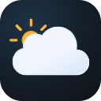
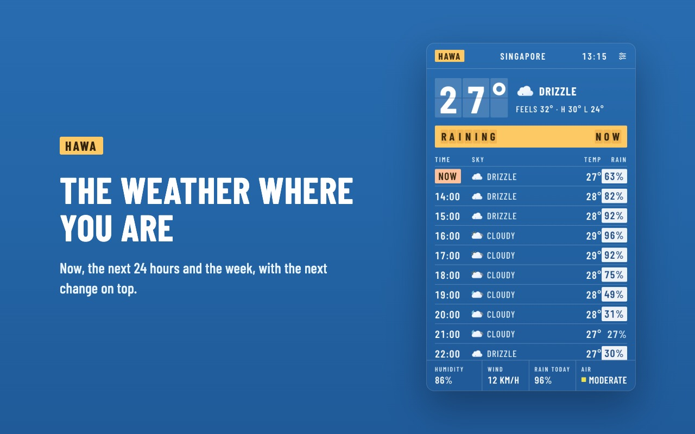
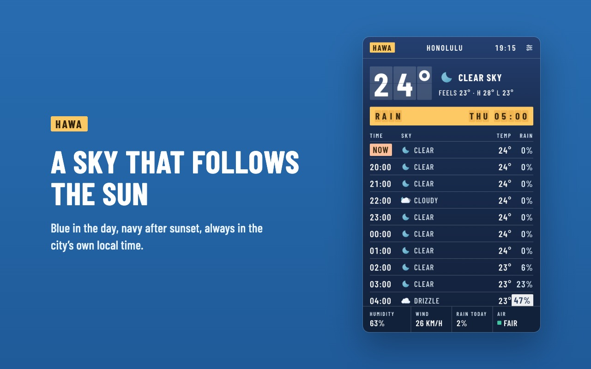
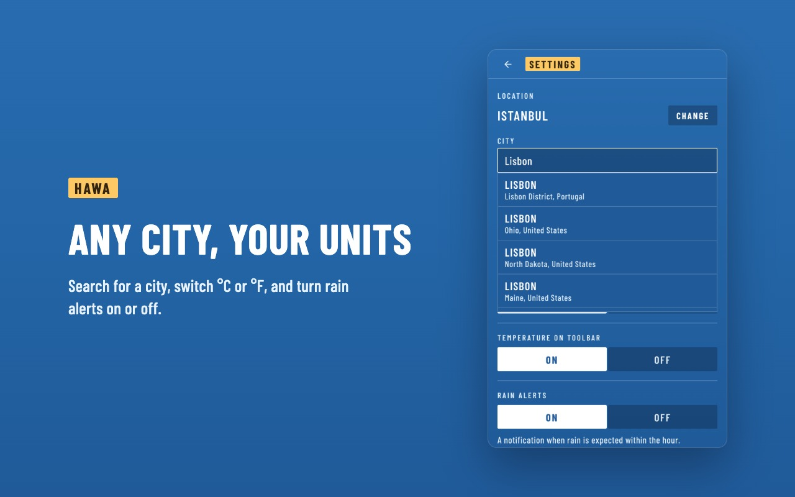

<p align="center">
  
</p>

<h1 align="center">Hawa</h1>

<p align="center">
  The real weather for where you are, with the temperature right on your toolbar.
</p>

<p align="center">
  
  
  
</p>

<p align="center">
  
</p>

Hawa (Arabic and Turkish for "air") shows the temperature on its toolbar icon, so most of the time you don't need to open anything. When you do, it answers the question you opened it for: is it going to rain, and when? It's free, needs no account and no API key, and has no servers of its own.

Hawa is the sister extension of [Vaqt](https://github.com/batuhan-bas/vaqt).

**Contents:** [For users](#for-users) · [FAQ](#faq) · [Privacy](#privacy) · [For developers](#for-developers) · [Credits](#credits) · [License](#license)

---

## For users

### Install

Hawa is in review for the Chrome Web Store. Once it's approved, the link will be here. After installing, pin it: click the puzzle icon in Chrome's toolbar and the pin next to Hawa, so the temperature is always in view.

### First run

The first time you open Hawa it asks where you are:

- **Share location**: Hawa follows your device. It only looks up a new place when you've moved about 5 km, so it doesn't ask again every time.
- **Search for a city**: start typing and pick a city from the list. Hawa keeps that city until you change it, even when you travel.

### What you see

From top to bottom:

- **The temperature now**, with the condition, feels like, and today's high and low
- **The next change**, on a yellow line: "Raining now", "Rain in about 30 min", "Rain Thu 05:00", or "No rain, next 48 h"
- **The next 24 hours**, hour by hour, with the chance of rain. Chances of 30% or more are highlighted
- **The week**, each day's sky, chance of rain, low and high
- **A bottom strip** with humidity, wind, today's chance of rain and air quality (European AQI)

All times are the chosen city's own local time, and the sky follows that city's sun: blue in the day, navy after sunset.

<p align="center">
  
  
</p>

### On the toolbar

The temperature shows on Hawa's icon, refreshed every 30 minutes. Hover over it to see the city and the condition.

### Rain alerts

When rain is expected within the next hour, Hawa sends a notification such as "Rain expected in about 30 minutes in Istanbul". It won't alert again for the same rain for 3 hours, and it stays quiet if it's already raining.

### Settings

Open them with the sliders icon in the top right.

| Setting | Options | Default |
|---|---|---|
| Location | Your current location, or a city you search for | Current location |
| Units | °C and km/h, °F and mph | °C, km/h |
| Clock | 24 hour, 12 hour | 24 hour |
| Temperature on toolbar | On, Off | On |
| Rain alerts | On, Off | On |

## FAQ

**The temperature on the icon is a few minutes behind the popup.**
The icon refreshes every 30 minutes; the popup loads fresh data each time you open it, so for a few minutes the two can differ by a degree.

**Location doesn't work.**
Hawa can only read your location if both Chrome and your operating system allow it:

- **Chrome:** open `chrome://extensions`, find Hawa, click **Details**, then **Site settings**, and set **Location** to **Allow**.
- **macOS:** System Settings → Privacy & Security → Location Services → turn on Google Chrome.
- **Windows:** Settings → Privacy & security → Location → allow apps, and allow your browser.

You can always skip this and search for your city instead.

**I don't get rain alerts.**
Check that **Rain alerts** is on in Hawa's settings, then that your system lets Chrome show notifications (macOS: System Settings → Notifications → Google Chrome; Windows: Settings → System → Notifications). Focus or Do Not Disturb modes hide them too.

**Does it work offline?**
It shows the last forecast it loaded right away, then needs a connection to refresh.

**Is Hawa in Turkish?**
The interface is in English for now. Turkish place names are shown with correct Turkish capitals (İZMİR, DİYARBAKIR).

## Privacy

Hawa has no servers of its own and tracks nothing. Your location, settings and the last forecast stay in your browser's local storage. To work, it sends:

- your coordinates to [Open-Meteo](https://open-meteo.com/), for the forecast and air quality
- the city you type to Open-Meteo's geocoding service, for city search
- your coordinates to [OpenStreetMap Nominatim](https://nominatim.org/), to show your city's name when you share your location

Read the full [privacy policy](https://batuhan-bas.github.io/hawa/privacy.html).

---

## For developers

Hawa is plain HTML, CSS and JavaScript on Manifest V3. There is no build step, no framework and no npm dependencies. Fonts and icons are bundled, so the extension loads nothing from third-party CDNs.

### Run it locally

1. Clone the repository.
2. Open `chrome://extensions` and turn on **Developer mode**.
3. Click **Load unpacked** and select the `hawa` folder.
4. After you change a file, click the reload icon on the Hawa card and reopen the popup.

To debug, right-click the popup and choose **Inspect**; for the background worker, click **service worker** on the Hawa card in `chrome://extensions`.

### Project structure

| Path | What it does |
|---|---|
| `manifest.json` | Permissions, host permissions, CSP and entry points |
| `popup.html`, `popup.css`, `popup.js` | The popup: the board, hourly and weekly rows, city search and settings |
| `background.js` | Service worker: refreshes every 30 minutes, sets the toolbar badge, sends rain alerts |
| `shared.js` | Code used by both: settings, API URLs, weather codes, the next-change and rain logic |
| `offscreen.html`, `offscreen.js` | Reads geolocation for the service worker, which has no access to it |
| `weather-icons/` | Meteocons SVGs and their license |
| `fonts/` | Barlow Condensed (latin and latin-ext) and its license |
| `privacy.html` | The privacy policy, also published on GitHub Pages |
| `PRODUCT.md`, `DESIGN.md` | Product context and the design system: palette, type, components, rules |

### How it works

1. **Forecast.** One request to Open-Meteo returns current conditions, 168 hourly values, 7 days and 15-minute precipitation for the next two hours, all with `timezone=auto`. Every time string is already the city's own wall clock, so there is no time zone conversion to get wrong.
2. **Air quality** comes from a separate Open-Meteo endpoint and never blocks the forecast: if it fails, the strip shows `--`.
3. **The next change** (`nextChange()` in `shared.js`): rain right now, then rain in the next hour from the 15-minute feed, then the first hour in the next 48 with a 50% or higher chance. Otherwise, "No rain, next 48 h".
4. **Rain alerts** (`minutesUntilRain()`): 0.1 mm or more in any 15-minute slot within the hour, skipped while it's already raining, at most once every 3 hours.
5. **Caching.** The last forecast is saved with its coordinates and units. The popup draws it at once, then refreshes; only the characters that changed flip.
6. **Location.** A city picked by hand is saved with `locationSource: 'manual'` and never replaced by GPS. With GPS, a new place name is looked up only after a move of about 5 km.
7. **Storage** (`chrome.storage.local`): `settings` (`lat`, `lng`, `city`, `countryCode`, `locationSource`, `unit`, `timeFormat`, `badge`, `rainAlerts`), `cache`, and `lastRainAlertAt`.

### Security

- The CSP allows scripts only from the extension itself: `script-src 'self'; object-src 'self'`.
- Text from APIs, such as place names, is always set with `textContent`, never `innerHTML`.
- Network access is limited to `api.open-meteo.com`, `air-quality-api.open-meteo.com`, `geocoding-api.open-meteo.com` and `nominatim.openstreetmap.org`.

### Design

The popup is a departure board under the sky: a blue day sky and a navy night sky, white condensed type in caps, split-flap cells for the temperature, and sun-yellow and peach plates for the few things that need warmth. Every text passes WCAG AA, and motion stops under `prefers-reduced-motion`. The full system, with its tokens and rules, is in [DESIGN.md](DESIGN.md).

### Release

1. Bump `version` in `manifest.json`.
2. Package the extension files:

   ```bash
   zip -r hawa.zip manifest.json background.js shared.js popup.html popup.js popup.css offscreen.html offscreen.js icons _locales fonts weather-icons
   ```

3. Upload the zip in the [Chrome Web Store Developer Dashboard](https://chrome.google.com/webstore/devconsole), and update the store's privacy answers if the permissions changed.

### Contributing

Keep it dependency-free, keep the permissions as narrow as they are, and follow [DESIGN.md](DESIGN.md) for anything visual.

## Credits

- Weather data by [Open-Meteo.com](https://open-meteo.com/) ([CC BY 4.0](https://creativecommons.org/licenses/by/4.0/))
- Place names © [OpenStreetMap contributors](https://www.openstreetmap.org/copyright)
- Weather icons: [Meteocons](https://github.com/basmilius/weather-icons) by Bas Milius ([MIT](weather-icons/LICENSE))
- Typeface: [Barlow Condensed](https://github.com/jpt/barlow) by The Barlow Project Authors ([SIL OFL 1.1](fonts/OFL.txt))

## License

[MIT](LICENSE)
